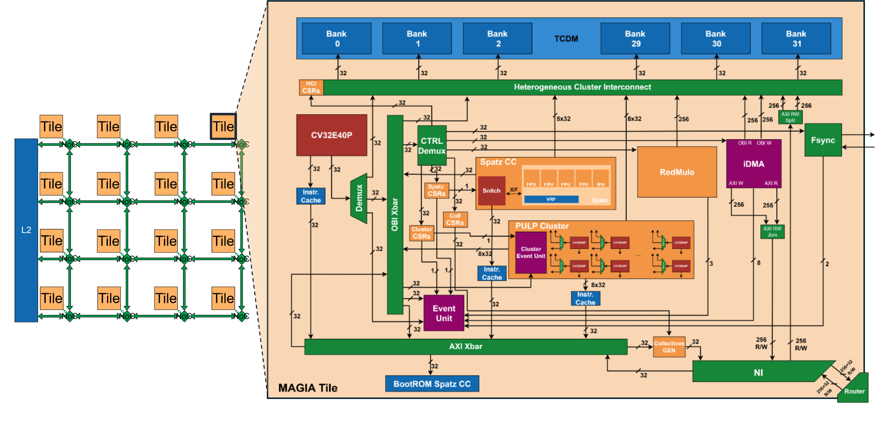
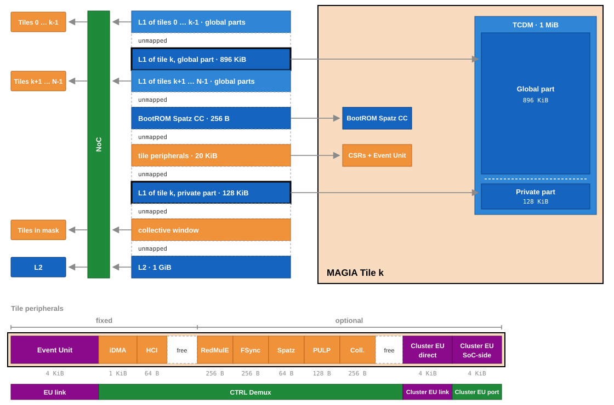
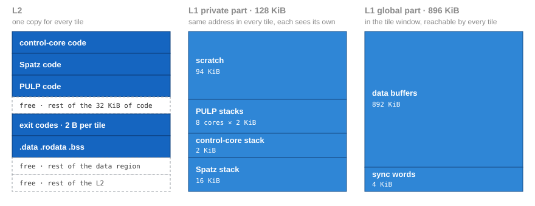

# MAGIA
[](LICENSE.APACHE)
[](LICENSE.SHL)

This repo contains MAGIA (**M**esh **A**rchitecture for **G**enerative **I**ntelligence **A**cceleration), an open-source large-scale accelerator designed for Generative Artificial Intelligence (GenAI). MAGIA is a network of tiles that have at their heart [RedMulE](https://github.com/pulp-platform/redmule) for General Matrix Multiply (GeMM) acceleration, [iDMA](https://github.com/pulp-platform/iDMA) for fast and efficient data movement, [Spatz Core Complex (Spatz CC)](https://github.com/pulp-platform/spatz) for vector workloads acceleration, a [PULP cluster](https://github.com/pulp-platform/cv32e40p) of 8 RISC-V cores for data-parallel workloads, and an L1 scratchpad memory (SPM). Tiles are connected to a mesh Network-on-Chip (NoC) - [FlooNoC](https://github.com/pulp-platform/FlooNoC) - used for communication, and a dedicated network for synchronization - [FractalSync](https://github.com/VictorIsachi/fractal_sync). Each tile is equipped with an [Event Unit](https://github.com/pulp-platform/event_unit_flex) for tile synchronization and event aggregation. MAGIA is designed to support matrices of sizes that vary by orders of magnitude, and also sparse matrix multiplication.

MAGIA is developed as part of the [PULP (Parallel Ultra-Low Power)](https://pulp-platform.org/) project, a joint effort between ETH Zurich and the University of Bologna.

## ⭐ Getting Started

### Pre-requisites

MAGIA uses [bender](https://github.com/pulp-platform/bender) to manage its dependencies and to automatically generate compilation scripts.

We use a virtual python environment which requires python>=3.6.8. To *create the envrionment* use (`MAGIA` folder):

```bash
make python_venv
```

By default, the `python` in your `$PATH` is used. You can specify the version by optionally exporting the `BASE_PYTHON` environment variable.

### Simulation

The following *optional* parameters can be specified:


`mesh_dv`: **0**|**1** (**Default**: 1). 0 simulation of a single tile; 1 simulation of the entire mesh.

`fast_sim`: **0**|**1** (**Default**: 0). 0 simulation that tracks signals (for debugging); 1 faster simulation that does not track signals.

`gui`: **0**|**1** (**Default**: 0). 0 simulation without GUI; 1 simulation with GUI.

`core`: **CV32E40P**|**CV32E40X** (**Default**: CV32E40P). Control core type; the cluster cores are always CV32E40P.

`fsync`: **0**|**1** (**Default**: 1). 1 builds the FractalSync network (`MAGIA_FSYNC`).


**Instructions to build HW/SW and run simulations**:

**1)** Setup the *environment* (`MAGIA` folder):
```bash
source setup_env.sh
```
**2)** Install *python dependencies* (`MAGIA` folder):
```bash
make python_deps
```
**3)** Download *Bender* (`MAGIA` folder):
```bash
make bender
```
Remember to export the bender binary to your `PATH` variable.
**4)** Clone the *dependencies* and generate the *compilation script* (`MAGIA` folder):
```bash
make vsim-scripts > vsim-scripts.log <mesh_dv> <core>
```
**5)** *Build* the hardware (`MAGIA` folder):
```bash
make build-hw > build-hw.log <mesh_dv> <fast_sim> <core>
```
**6)** *Compile* the test code (`MAGIA` folder):
```bash
make all <test> <mesh_dv> <core>
```
**7)** *Run* test (`MAGIA` folder):
```bash
make run <test> <gui> <mesh_dv> <fast_sim> <core>
```

**Full example**:
```bash
make python_venv
source setup_env.sh
make python_deps
make bender
make vsim-scripts > vsim-scripts.log 
make build-hw > build-hw.log fast_sim=1
make all test=fsync_test
make run test=fsync_test
```

### Simulation with Verilator

MAGIA can also be simulated with [Verilator](https://verilator.org) instead of
QuestaSim. The flow is independent of the `vsim` one above: it has its own
targets, its own build directories under `verilator/`, and needs no
`build-hw`/`vsim-scripts` step.

`mesh_dv` picks the model, as in the Questa flow:

- `mesh_dv=1` builds the mesh (`magia_tb`) **hierarchically**: the tile is
  compiled once into a separate library (`magia_tile_hier`) and instantiated
  for every tile, instead of being flattened. This keeps the build tractable.
- `mesh_dv=0` builds the standalone tile (`magia_tile_tb`).

The following *optional* parameters can be specified:

`core`: **CV32E40P**|**CV32E40X** (**Default**: CV32E40P). Each core and each
`mesh_dv` has its own build directory, so the models can be built side by side.

`VERILATOR_JOBS`: **N** (**Default**: 16). Parallelism used to *build* the model.
Unrelated to simulation speed.

`VERILATOR_THREADS`: **N** (**Default**: 4 for the mesh, 1 for the tile). Threads the *simulation itself* runs on. See
the note below before changing it.

`VERILATOR_FST`: **&lt;file&gt;** (**Default**: empty). Dump a waveform to this file.

`OBJCACHE`: **ccache** (**Default**: empty). Compiler cache for the model. Off by
default: ccache 3.x can serve objects of an older model with Verilator's
precompiled headers, and the model then segfaults at time zero.

**Instructions to build and run a Verilator simulation**:

**1)** *Build* the model (`MAGIA` folder):
```bash
make verilate core=CV32E40P mesh_dv=1 VERILATOR_JOBS=16
```
**2)** *Compile and run* a test (`MAGIA` folder):
```bash
make verilate-run core=CV32E40P mesh_dv=1 test=inter_l1_test
```
Step **1** is *required at least once*: `verilate-run` compiles the test but
never the model — it runs the model already built for that `mesh_dv` and
`core`, and errors out if there is none.
**After changing the RTL, re-run `make verilate` yourself**, or you will keep simulating the old model.

**Full example**:
```bash
source setup_env.sh
make verilate core=CV32E40P mesh_dv=1 VERILATOR_JOBS=16
make verilate-run core=CV32E40P mesh_dv=1 test=inter_l1_test
```

Other targets: `verilate-gen` (code generation only), `verilate-build` (native
compile only), `verilate-check-hierarchy` (asserts the model really links the
tile library instead of inlining it), and `clean-verilate`.

#### Single tile

`mesh_dv=0` builds the standalone tile (`magia_tile_tb`) in its own build
directory, and runs the same tile tests as the Questa flow (`make run mesh_dv=0`):

```bash
make verilate core=CV32E40P mesh_dv=0 VERILATOR_JOBS=16
make verilate-run core=CV32E40P mesh_dv=0 test=hello_world
```

#### Waveforms (FST)

The model is **always** built with tracing compiled in, so no rebuild is needed
to capture a waveform. Dumping is off until a run asks for it, and a run that
does not ask pays nothing beyond a larger binary:

```bash
make verilate-run core=CV32E40P mesh_dv=1 test=inter_l1_test VERILATOR_FST=dump.fst
```

The file is written in the test's build directory. Waveforms include the
internals of every tile.

`Ctrl-C` (or `SIGTERM`) stops the run at the next time step and still closes
the FST, so an interrupted run leaves a waveform you can open.

#### Multithreaded simulation (experimental)

`VERILATOR_THREADS=8` runs the model on 8 threads:

```bash
make verilate core=CV32E40P mesh_dv=1 VERILATOR_JOBS=16 VERILATOR_THREADS=8
make verilate-run core=CV32E40P mesh_dv=1 test=inter_l1_test
```

`VERILATOR_THREADS` is compiled *into* the model, so it belongs on `verilate`
only — passing it to `verilate-run` does nothing, and does not rebuild anything.
To change the thread count, re-run `make verilate` with the new value.

**This is experimental and only partially tested.** What is actually known:

- `VERILATOR_THREADS=8` halved `inter_l1_test` (132 s → 66 s, same result, same
  `$finish` time). Only that one test was checked, once.
- `VERILATOR_THREADS=4` is the mesh default, used by the regression.

## ⚙️ Architecture



### Tile
The central piece of the architecture is the MAGIA tile containing a GeMM accelerator, a Vector Processor, a DMA engine, a PULP cluster of RISC-V cores, a multi-banked L1 SPM, an Event Unit, and a lightweight control core. The L1 features interleaved memory banks that compose the Tightly-Coupled Data Memory (TCDM). Each tile has access to the global L2 and to a subset of other tiles' L1, accessing the latter via on-chip remote direct memory access (RDMA). Inter-tile and global communication is carried out through AXI-based narrow (32-bit) and wide (256-bit) NoC channels in [FlooNoC](https://github.com/pulp-platform/FlooNoC). External tiles access the L1 through an OpenBus Interface ([OBI](https://github.com/pulp-platform/obi)) XBAR, the control core through its own HCI port.

Each tile is controlled by a [CV32E40P](https://github.com/pulp-platform/cv32e40p) or [CV32E40X](https://github.com/openhwgroup/cv32e40x) main core (`core=`). Control of iDMA, RedMulE, FractalSync, Spatz CC, and the PULP cluster follows a memory-mapped model, with the Event Unit handling event aggregation for system control.

`magia_tile` wraps `magia_isle` (cores, accelerators, L1, crossbars and Event Unit) with the FlooNoC network interface and router. What a tile contains is set by its `TileCfg` (`magia_tile_cfg_t` in `hw/mesh/magia_pkg.sv`).

Memories of a tile with the default `TileCfg`:

| Memory | Size | Organization |
|---|---|---|
| L1 (TCDM) | 1 MiB: 128 KiB private + 896 KiB global | 32 banks x 8192 words x 32 bit |
| PULP cluster I$ | 8 KiB, shared by the 8 cores | 4 ways x 64 lines x 256 bit |
| Control-core I$ | 2 KiB | 4 ways x 32 lines x 128 bit |
| Spatz CC I$ | 2 KiB | 2 ways x 32 lines x 256 bit |

### Mesh
Replicating the MAGIA tile, we scale up to a two-dimensional (2D) mesh of compute tiles. Each tile takes its `TileCfg` from the `TILE_CFGS` parameter of `magia` (`HOMO_TILE_CFGS` by default). The NoC allows access to the global west-side L2 through row-side interfaces, while tiles exchange traffic through FlooNoC router. The mesh uses XY routing and carries both AXI narrow channels (32-bit) and AXI wide channels (256-bit), with protocol conversion handled by per-tile Network Interfaces (NIs).

Rendez-vous among tiles are managed through the FractalSync (FS) mechanism and the dedicated network.

The routers also implement collective operations (multicast, broadcast, reduction, barrier) in
hardware: see [Collective Operations](#collective-operations).


### Memory map
The hardware sets where each memory and peripheral answers (`hw/tile/magia_tile_pkg.sv`); the
software sets where code, data and stacks go ([Software layout](#software-layout)).



Address space seen by tile k, with N tiles (up to 16x16) and tile j from 0 to N-1, ends included:

| Start                           | End                                 | Region |
|---------------------------------|-------------------------------------|--------|
| `j * 0x0010_0000`               | `j * 0x0010_0000 + 0x0001_FFFF`     | Unmapped |
| `j * 0x0010_0000 + 0x0002_0000` | `j * 0x0010_0000 + 0x000F_FFFF`     | L1 of tile j, global part (896 KiB) |
| `N * 0x0010_0000`               | `0x0FFF_FFFF`                       | Unmapped |
| `0x1000_0000`                   | `0x1000_00FF`                       | Spatz CC BootROM |
| `0x1000_0100`                   | `0x9FFF_FFFF`                       | Unmapped |
| `0xA000_0000`                   | `0xA000_4FFF`                       | Tile peripherals (below) |
| `0xA000_5000`                   | `0xA00F_FFFF`                       | Unmapped |
| `0xA010_0000`                   | `0xA011_FFFF`                       | L1 of tile k, private part (128 KiB) |
| `0xA012_0000`                   | `0xAFFF_FFFF`                       | Unmapped |
| `0xB000_0000`                   | `0xB000_0000 + N * 0x0010_0000 - 1` | Collective window |
| `0xB000_0000 + N * 0x0010_0000` | `0xBFFF_FFFF`                       | Unmapped |
| `0xC000_0000`                   | `0xFFFF_FFFF`                       | L2 (1 GiB) |

A smaller L1 keeps the same map: with `N_WORDS_BANK` = 2048 (256 KiB) the global part ends at
`j * 0x0010_0000 + 0x0003_FFFF` and the rest of the window is unmapped. Set `WORDS_BANK` and
`L1_PRIV_SIZE` in `sw/utils/magia_tile_utils.h` to the instantiated sizes.

**Tile peripherals.** Units every tile has come first, the optional ones after. An absent unit or
an unmapped address answers with an OBI error, which stops the test in simulation.

| Start         | End           | Unit |
|---------------|---------------|------|
| `0xA000_0000` | `0xA000_0FFF` | Ctrl-core Event Unit |
| `0xA000_1000` | `0xA000_13FF` | iDMA CTRL |
| `0xA000_1400` | `0xA000_143F` | HCI CTRL |
| `0xA000_1440` | `0xA000_1FFF` | Free |
| `0xA000_2000` | `0xA000_20FF` | RedMulE CTRL (optional) |
| `0xA000_2100` | `0xA000_21FF` | FractalSync CTRL (optional) |
| `0xA000_2200` | `0xA000_223F` | Spatz CTRL (optional) |
| `0xA000_2300` | `0xA000_237F` | PULP CTRL (optional) |
| `0xA000_2400` | `0xA000_24FF` | Collective CTRL (optional) |
| `0xA000_2500` | `0xA000_2FFF` | Free |
| `0xA000_3000` | `0xA000_3FFF` | Cluster Event Unit, direct (cluster cores only) |
| `0xA000_4000` | `0xA000_4FFF` | Cluster Event Unit, SoC-side |

**Simulation only**, decoded by the testbench VIP:

| Address       | Use |
|---------------|-----|
| `0xFFFF_0000` | Memory-mapped stderr sink |
| `0xFFFF_0004` | Memory-mapped stdio sink |

### Software layout
Set by the software (`sw/utils/magia_tile_utils.h`, the linker scripts and the crt0 files). Every
tile runs the same ELF; the L2 part is contiguous from `0xC000_0000`.



| Start                           | End                             | Memory     | Region |
|---------------------------------|---------------------------------|------------|--------|
| `0xC000_0000`                   | `0xC000_7FFF`                   | L2         | Code: control core, then the embedded Spatz and PULP binaries |
| `0xC000_8000`                   | `0xC000_87FF`                   | L2         | Exit codes, 2 B per tile, read by the testbench |
| `0xC000_8800`                   | `0xC0FF_FFFF`                   | L2         | `.data`, `.rodata`, `.bss`, shared by every tile |
| `0xC100_0000`                   | `0xFFFF_FFFF`                   | L2         | Free |
| `k * 0x0010_0000 + 0x0002_0000` | `k * 0x0010_0000 + 0x000F_EFFF` | L1 global  | Data buffers (`L1_BASE + mhartid * L1_TILE_OFFSET`) |
| `k * 0x0010_0000 + 0x000F_F000` | `k * 0x0010_0000 + 0x000F_FFFF` | L1 global  | Sync words (`SYNC_BASE`) |
| `0xA010_0000`                   | `0xA011_77FF`                   | L1 private | Scratch (`SCRATCH_BASE`) |
| `0xA011_7800`                   | `0xA011_B7FF`                   | L1 private | PULP stacks, 8 x 2 KiB |
| `0xA011_B800`                   | `0xA011_BFFF`                   | L1 private | Control-core stack, 2 KiB |
| `0xA011_C000`                   | `0xA011_FFFF`                   | L1 private | Spatz stack, 16 KiB |

Stacks have the same address in every tile; data shared with other tiles, DMA or collectives goes
in the global part.

## 🖥️ Programming model
The flow is memory-mapped (MM): software configures and starts accelerators by writing control registers in each tile address space.

- Execution model: SPMD over tiles, with `mhartid` selecting `tile_base = mhartid * L1_TILE_OFFSET`.
- Control path: the control core (CV32E40P or CV32E40X) accesses RedMulE, iDMA, FractalSync, Event Unit, and Spatz control registers via MMIO.
- Data path: iDMA moves data between L1 and external memory, while compute engines consume/produce data in L1.
- Synchronization: Event Unit and FractalSync provide interrupt/event and barrier mechanisms for inter-tile coordination.

Software APIs for MM control are under `sw/utils/` (for example `redmule_mm_utils.h`, `idma_mm_utils.h`, `fsync_mm_api.h`, `magia_spatz_utils.h` and `event_unit_utils.h`).

### Accelerators
The control core drives each accelerator through its registers and waits for it by polling or on
its Event Unit (`event_unit_utils.h`).

#### iDMA
Moves data between the tile's L1 and the L2 or another tile's L1 (`idma_mm_utils.h`):
`idma_L2ToL1(src, dst, len)` and `idma_L1ToL2(src, dst, len)` start a transfer, `dma_wait(id)`
waits for it. It also issues the wide collectives.

#### RedMulE
GeMM engine on operands in L1 (`redmule_mm_utils.h`): `hwpe_acquire_job()` reserves it,
`redmule_cfg(..)` sets addresses, sizes and format, `hwpe_trigger_job()` starts it and
`hwpe_wait_for_completion()` waits for the end.

#### Spatz CC
Vector core complex running tasks from the Spatz binary embedded in the CV32 ELF
(`magia_spatz_utils.h`): `spatz_init(..)` boots it, `spatz_run_task(..)` starts a task and
`eu_wait_spatz_polling(..)` waits for it. See [spatz/README.md](spatz/README.md).

#### PULP Cluster
Each tile embeds a cluster of `TileCfg.Cluster.NumCores` (8 by default) [CV32E40P](https://github.com/pulp-platform/cv32e40p) cores with a shared instruction cache and their own [Event Unit](https://github.com/pulp-platform/event_unit_flex) (dispatch FIFO, hardware barriers and mutex).

The PULP cluster uses a bare-metal, two-level dispatch model. The cluster binary is compiled as a position-independent ELF (origin `0x0`), converted to a flat binary, and embedded in the CV32 ELF as a byte array in the `.pulp_binary` section (see `sw/kernel_pulp/`).

**Main core → cluster core 0** (`sw/utils/cluster_utils.h`, `sw/utils/magia_pulp_utils.h`):

1. `cluster_boot(binary_start)` — writes `PULP_BINARY`, sets `PULP_FETCH_EN`, polls `PULP_READY` until all cluster cores have booted.
2. `cluster_arm_done_event()` — clears the CV32 Event Unit buffer and enables only EU bit 12 (cluster-done).
3. `cluster_dispatch_task(task_addr)` — writes `PULP_TASKBIN`/`PULP_DATA` and rings `PULP_START`; returns once core 0 has taken the task.
4. `cluster_wait_done_eu()` — the control core sleeps on a blocking Event Unit load (`cv.elw` on CV32E40P, `lw` on CV32E40X) until EU bit 12 fires.

**Core 0 → the other cores** (`sw/utils/cluster_utils.h`): `pi_cl_team_fork(n, entry, arg)` runs `entry(arg)` on `n` cores through the cluster Event Unit and ends on a hardware barrier, as in the pulp-sdk API.

Cluster task sources live under `sw/tests/<test>/pulp_task/`. A test directory containing a `pulp_task/` subdirectory automatically triggers the dual-binary build flow in the Makefile.

### Collective Operations
Beyond point-to-point traffic, the routers also implement **collective** operations in hardware: a single transaction can be replicated towards a whole row, column, or the entire mesh (multicast/broadcast), and many transactions can be aggregated on their way to a single destination (reduction, barrier).

Two extra fields on the AXI `user` channel tag a transaction as collective:
```sv
typedef struct packed {
    logic [31:0] collective_mask;  // which tiles take part
    logic [3:0]  collective_op;    // what the routers do with the flits
} axi_user_t;
```
`collective_op` alone decides whether a transaction is collective. `UNICAST` (`0`) means
ordinary point-to-point traffic, and the FlooNoC NI (`chimney`) then **forces the mask to zero**
regardless of what software wrote. So setting a mask without setting an opcode has no effect.
Other available opcodes are: `MULTICAST` (1), `LSBAND` (2, used as a barrier), `FP_ADD`/`FP_MUL`/`FP_MIN`/
`FP_MAX` (3-6), `INT_ADD`/`INT_MUL` (7-8), `INT_MINS`/`INT_MINU`/`INT_MAXS`/`INT_MAXU`
(9-12).

MAGIA configures FlooNoC so that each address region - associated to a tile in the System Address Map (SAM) - is identified by an `x_id` and `y_id` with the corresponding masks:

```sv
// One entry of CollectiveSam (2x2 mesh)
'{
  idx: '{
      id:     '{x: 3, y: 1, port_id: 0},
      mask_x: '{ offset: 20, len: 1, base_id: 2},
      mask_y: '{ offset: 21, len: 1, base_id: 0}
      },
  start_addr: 32'h00300000,
  end_addr:   32'h00400000}
}  // MagiaTileX1Y1
```
`mask_x`/`mask_y` come with the following structure:
| Field | Meaning | Value for a MAGIA mesh |
|---|---|---|
| `offset` | Position of the field in the address / mask word | `x` at 20; `y` directly above it |
| `len`    | Width of the field | 1 for 2x2, 2 for 4x4, 4 for 16x16 |
| `base_id`| Mesh coordinate of tile (0,0) | `base_id` is non-zero for the `x` coordinate because we add an offset to the `x_id` of each MAGIA tile. This offset is required to exclude the memory tiles from the collective operations. More details can be found in  https://doi.org/10.48550/arXiv.2603.26438.|

Routing is ordinary XY with one addition: every bit **set** in
`collective_mask` is a *don't care* on the corresponding destination ID. A
router forwards a flit to every output whose coordinate matches the destination ID on the
bits that are not masked:

Example on a 4x4 mesh - two masked `x` bits and one masked `y` bit give 4 x 2 = 8 destinations:

```text
DEST_ID = (X_ID, Y_ID) = (01, 00)
MASK    = (MASK_X, MASK_Y) = (11, 10)

DEST_ID[0] = (00, 00)    DEST_ID[4] = (10, 00)
DEST_ID[1] = (00, 10)    DEST_ID[5] = (10, 10)
DEST_ID[2] = (01, 00)    DEST_ID[6] = (11, 00)
DEST_ID[3] = (01, 10)    DEST_ID[7] = (11, 10)
```

An all-zero mask is plain unicast; masking the `x` field gives a row multicast, the `y` field a
column, both a broadcast. Reductions use the same mask: the
router derives the set of contributors it must wait for and merges their flits as they
converge on the destination.

MAGIA supports collectives on both the narrow and the wide FlooNoC channel, through two
independent programming paths.

#### Wide channel
The wide channel is used exclusively by the iDMA. Only multicast and broadcast are
supported here; the typical use is pushing one tile's L1 buffer into every other tile's L1.
Mask and opcode live in the iDMA's own registers, not in the tile CSRs, and are set for you
by `collective(..)` in [idma_mm_utils.h](sw/utils/idma_mm_utils.h):

```c
printf("Multicast over the row...\n");
uint32_t transfer_id_1 = collective(dst_addr, broad_addr, len, gen_collective_mask(ROW), MULTICAST);
dma_wait(transfer_id_1);   // poll for completion
```

#### Narrow channel
The narrow channel can be used to issue barrier, reduce and multicast transactions. Before issuing a collective over the narrow channel two tile CRSs must be properly configured:

| Register | Meaning |
|---|---|
| `COLLECTIVE_MASK` | *Which* tiles take part |
| `COLLECTIVE_OP`   | *What* the routers do with the flits |

A store is then tagged collective if it is written at `COLLECTIVE_ADDR_OFFSET`, the collective window. The APIs required to configure and use collective transactions over the narrow channel can be found in [magia_coll_utils.h](sw/utils/magia_coll_utils.h).

**Programming flow**
1. `set_collective_mask()` to set the `COLLECTIVE_MASK` register
2. `set_collective_op()` to set the `COLLECTIVE_OP` register
3. A store in the collective window is then interpreted as a collective transaction

## 🧰 Changing number of tiles
**Supported Mesh Configurations**: `2x2`, `4x4`, `8x8`, `16x16`, `32x32`

**Scripts**: The `num_cores` parameter in the `Makefile` specifies for how many core stack traces should be generated.

**Tests**  : The `MESH_X_TILES` and `MESH_Y_TILES` parameters in `sw/utils/magia_utils.h` adapt the software stack to the specific mesh configuration.

**RTL/TB** : The `N_TILES_X` and `N_TILES_Y` parameters in `hw/mesh/magia_pkg.sv` specifie the number of tiles and allows the derivation of the appropriate data and syncrhonization networks.

## 🧪Local testing
The [`run_regression.py`](scripts/run_regression.py) Python script builds the hardware and software and runs the tests listed in [`tests.yml`](sw/tests/tests.yml), for Questa and Verilator. It is invoked from the main directory of this repository:
```sh
scripts/run_regression.py --sim questa --core CV32E40P --fsync on --test general/hello_mesh   # one test
scripts/run_regression.py --sim all --core all --fsync all --test all                         # everything
scripts/run_regression.py --sim all --core all --fsync all --test all --list                  # plan only
```

`scripts/run_regression.py -h` lists every option.

## 🔏 License
MAGIA is an open-source project with a permissive license. All `software` sources are licensed under the Apache License 2.0 ([`LICENSE.APACHE`](LICENSE.APACHE)). All `hardware` sources are licensed under the Solderpad Hardware License 0.51 ([`LICENSE.SHL`](LICENSE.SHL)).

